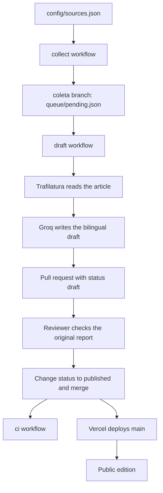

# News, explained

A static bilingual edition of short news explanations. Brazil opens the site. World keeps up to three highlights, then the latest stories. Search and filters live in the page address.

The stories in this repository are layout samples. They are not reviewed journalism.

## Publication flow

A headline becomes a public story only after a person checks the original report and merges it to `main`.



1. **Collect.** The `collect` workflow runs at minutes 17 and 47, or from the Actions tab. It reads the feeds in `config/sources.json` and, when a headline is new, commits title, date, and link to `queue/pending.json` on the `coleta` branch. The article text stays out of the repository. This branch does not deploy.
2. **Draft.** The `draft` workflow runs daily at 12:20 UTC, or from the Actions tab. It takes up to two queued headlines, extracts each article with Trafilatura, and asks Groq for the Portuguese and English explanation. It opens a pull request whose stories have `status: "draft"`. Drafts are not listed on the public site.
3. **Review.** Open the original report linked in the story. Check the date, the numbers, and the stage. In `meta.json`, change `status` from `draft` to `published`.
4. **Publish.** Merge the pull request into `main`. The `ci` workflow validates the content and builds the site. Vercel deploys `main`. The story appears on [newshell-eight.vercel.app](https://newshell-eight.vercel.app). A later correction stays at the same address.

`GROQ_API_KEY` must exist as an Actions secret before the draft workflow can call Groq.

## Local check

```bash
npm ci
npm test
npm run validate:content
npm run build
npm start
```

Open `http://localhost:8080/pt-br/brasil/`, reload a story, and switch between Português and English.

`SITE_URL` is the public `https` origin used in shared links and social previews. Local builds fall back to `http://localhost:8080`. On Vercel, `SITE_URL` wins when it is set; otherwise the build uses `VERCEL_PROJECT_PRODUCTION_URL`.

## Deploy

The Vercel project should track `main` on the Hobby plan.

- Framework preset: Other
- Install command: `npm ci`
- Build command: `npm run validate:content && npm run build`
- Output directory: `out`
- Node.js: 24

`vercel.json` already carries those commands. Builds for branches other than `main`, including `coleta`, are ignored. Pull requests are checked by GitHub Actions.

## Edition files

Approved stories live in `content/stories/<id>/` with `meta.json`, `pt-br.md`, and `en.md`. Interface copy is in `locales/`. Feed registration is `config/sources.json`.

`python3 scripts/collect.py` stores headlines, dates, and links in `queue/`. It does not store full articles. The scheduled workflow commits that queue on the `coleta` branch only when the metadata changes.

`python3 scripts/draft.py` reads that queue, extracts the article with Trafilatura, and asks Groq for a bilingual draft. The article text is not committed. New stories are saved with `status: "draft"` and stay off the public edition. The `draft` workflow opens a pull request. Read the original report, then change `status` to `published` before merging.

Create a free key at [console.groq.com](https://console.groq.com/) and save it as the Actions secret `GROQ_API_KEY`. `GROQ_MODEL` defaults to `openai/gpt-oss-20b`. `DRAFT_LIMIT` defaults to 2 stories per run.

## Fonts

Newsreader and Source Sans 3 are stored in `app/fonts/` with their OFL licenses.
